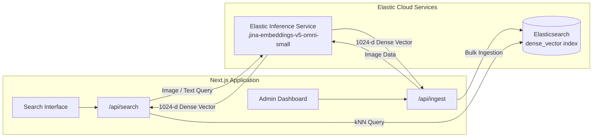

# Madstylehub Visual Search Backend

Multimodal visual and facial similarity search service powered by Elasticsearch and Jina embeddings. This service supports image-to-image similarity, facial recognition search across group photos, text-to-image search, and camera uploads.

[](LICENSE)
[](https://www.elastic.co/elasticsearch)
[](https://nextjs.org)
[](https://www.typescriptlang.org)
[](https://eui.elastic.co)

---

## Table of Contents

- [Overview](#overview)
- [Key Features](#key-features)
- [Architecture and How It Works](#architecture-and-how-it-works)
  - [Visual Search Pipeline](#visual-search-pipeline)
  - [Facial Search Pipeline](#facial-search-pipeline)
- [Getting Started](#getting-started)
  - [Prerequisites](#prerequisites)
  - [Installation and Setup](#installation-and-setup)
- [Configuration](#configuration)
  - [Environment Variables](#environment-variables)
  - [Inference Endpoint Options](#inference-endpoint-options)
  - [Switching Models](#switching-models)
- [Usage](#usage)
  - [Search Interface](#search-interface)
  - [Administration Panel](#administration-panel)
  - [Rate Limiting](#rate-limiting)
- [API Reference](#api-reference)
- [Project Structure](#project-structure)
- [Development and Testing](#development-and-testing)
- [Docker Deployment](#docker-deployment)
- [Cloud Deployment (AWS Amplify & S3)](#cloud-deployment-aws-amplify--s3)
- [Contributing](#contributing)
- [License](#license)

---

## Overview

Madstylehub Visual Search Backend provides high-performance vector search capabilities across visual and facial assets. Built on Elasticsearch approximate kNN and Jina multimodal models deployed via the Elastic Inference Service, the system projects images and text into a shared 1024-dimensional vector space.

---

## Key Features

- **Image-to-Image Search**: Query using an uploaded image to retrieve visually similar items based on style, composition, and content.
- **Camera Search**: Capture photos directly from desktop or mobile front/rear cameras to perform instant searches.
- **Text-to-Image Search**: Query visually indexed items using natural language descriptions.
- **Face Search and Per-Face Cropping**: Detect multiple faces in group photos using client-side SSD MobileNet, generate embeddings per face, and match identities using centered cosine similarity.
- **Visual Similarity Pivot**: Drill down from any search result to discover similar items in the catalog.
- **Administrative Portal**: Manage ingestion batches, monitor duplicate detection via SHA-256 hashing, trigger face scanning, and configure cluster settings.
- **Configurable Rate Limiting**: Token-bucket per-IP rate limiting to safeguard inference and search endpoints.
- **Responsive Interface**: Theme-aware UI built with Elastic UI supporting light and dark modes.
- **Zero Local GPU Dependencies**: Utilizes Elastic Cloud managed inference endpoints (`.jina-embeddings-v5-omni-small`).

---

## Architecture and How It Works



### Visual Search Pipeline

1. **Ingestion**: Uploaded images are hashed (SHA-256) to ensure deduplication. Unique images are submitted to the Elastic Inference Service for embedding and indexed in Elasticsearch within an HNSW-indexed `dense_vector` field using cosine similarity.
2. **Search Execution**: Query images or text prompts are vectorized within the same embedding space, and Elasticsearch executes an approximate kNN search against the indexed vectors.

### Facial Search Pipeline

1. **Face Detection**: During upload, client-side SSD MobileNet (`@vladmandic/face-api`) locates all faces with confidence above 70%, filtering out false positives.
2. **Per-Face Embedding**: Each cropped face is embedded via the multimodal endpoint and stored in a `nested` `faces` field within the parent photo document.
3. **Candidate Retrieval and Re-scoring**: A nested kNN query retrieves top candidate photos. Candidate faces are re-scored after subtracting the baseline average face vector, expanding match separation (positive matches typically score 0.40–0.80, whereas non-matching faces fall below 0.30).

> **Note on Biometric Data**: Face vectors constitute biometric information. Ensure appropriate compliance, consent, and user disclosures prior to production deployment.

---

## Getting Started

### Prerequisites

- Node.js 20.x or higher
- An Elastic Cloud deployment (Serverless or Hosted) with preconfigured `.jina-embeddings-v5-omni-small` inference endpoint
- An Elasticsearch API key with index and inference privileges

### Installation and Setup

1. **Clone the repository**:
   ```bash
   git clone https://github.com/MadhavanAR/Madstylehub-Backend.git
   cd Madstylehub-Backend
   ```

2. **Install dependencies**:
   ```bash
   npm install
   ```

3. **Configure local environment variables**:
   ```bash
   cp .env.example .env.local
   ```
   Provide your cluster credentials in `.env.local`:
   ```env
   ES_URL=https://your-project.es.us-central1.gcp.elastic.cloud:443
   ES_API_KEY=your-api-key
   ADMIN_PASSWORD=your-secure-admin-password
   ```

4. **Initialize the index**:
   ```bash
   npm run setup-index
   ```

5. **Start the development server**:
   ```bash
   npm run dev
   ```

Access the search interface at `http://localhost:3000` and the administration panel at `http://localhost:3000/admin`.

---

## Configuration

### Environment Variables

Configuration parameters can be defined via environment variables or adjusted in the admin dashboard:

| Variable | Required | Default | Configurable via Admin UI | Description |
| :--- | :--- | :--- | :--- | :--- |
| `ES_URL` | Yes (or `ES_CLOUD_ID`) | - | Yes | Elasticsearch cluster endpoint URL |
| `ES_CLOUD_ID` | Yes (or `ES_URL`) | - | Yes | Elastic Cloud deployment identifier |
| `ES_API_KEY` | Yes | - | Yes | Elasticsearch API authentication key |
| `ES_INDEX` | No | `photos` | Yes | Target Elasticsearch index name |
| `INFERENCE_ID` | No | `.jina-embeddings-v5-omni-small` | Yes | Endpoint ID for embeddings |
| `STORAGE_DIR` | No | `./storage` | No | Local filesystem path for uploads |
| `ADMIN_PASSWORD` | Yes | - | Yes | Initial administrator access password |
| `SESSION_SECRET` | No | Derived from `ADMIN_PASSWORD` | No | Secret key for signing session tokens |
| `DATA_DIR` | No | `./data` | No | Path for persisting runtime configuration |
| `S3_BUCKET` | No | - | No | Optional AWS S3 bucket name for cloud asset storage |
| `S3_REGION` | No | AWS Default | No | Target AWS region for S3 operations |

### Inference Endpoint Options

`INFERENCE_ID` must point to an endpoint supporting:
- `embedding` task type (`POST _inference/embedding/<id>`)
- Multimodal inputs (accepts base64 images and text strings)
- Dense vector outputs

Tested models include `.jina-embeddings-v5-omni-small` (default, 1024-d), `.jina-clip-v2` (1024-d), and `.jina-embeddings-v5-omni-nano` (faster, lightweight).

### Switching Models

- **Same Dimensionality (e.g., 1024-d)**: Update `INFERENCE_ID` in `.env.local` or the admin panel, then run `npm run reembed` to vectorize stored assets without re-uploading.
- **Different Dimensionality**: Test connection and recreate index via the admin UI or command line (`npm run setup-index -- --recreate`), followed by re-uploading assets.

---

## Usage

### Search Interface

- **Visual Query**: Drag and drop or upload an image file to trigger vector comparison.
- **Camera Mode**: Capture an image live; automatically requests camera permissions over HTTPS or localhost.
- **Face Search Tab**: Select individual face crops from group photos to isolate search targets.
- **Similarity Threshold**: Adjust the minimum similarity filter slider to refine result precision without additional network requests.

### Administration Panel

- Accessible at `/admin` (session valid for 7 days upon authentication).
- **Photos Management**: Batch upload images, monitor ingestion queues, and verify deduplication.
- **Face Scanner**: Run retrospective facial recognition indexing on previously stored photos.
- **System Settings**: Dynamically update cluster endpoints, toggle search rate limiting, or rotate the administrative password.

### Rate Limiting

The built-in sliding window rate limiter protects endpoints from excessive requests. Rate limits include standard response headers (`X-RateLimit-Limit`, `X-RateLimit-Remaining`, `X-RateLimit-Reset`). When exceeded, endpoints return `429 Too Many Requests` with a `Retry-After` header.

---

## API Reference

| Method | Endpoint | Authorization | Description |
| :--- | :--- | :--- | :--- |
| `POST` | `/api/search` | Public | Executes vector search (`image`, `text`, `id`, `face`, or `face-id`) |
| `GET` | `/api/images/:file` | Public | Serves stored visual assets |
| `POST` | `/api/auth/login` | Public | Authenticates admin session and sets HTTP-only cookie |
| `POST` | `/api/auth/logout` | Public | Terminates active administrator session |
| `GET` | `/api/ingest` | Admin | Returns count of indexed documents |
| `POST` | `/api/ingest` | Admin | Multi-part upload handler for indexing assets |
| `GET` | `/api/admin/settings` | Admin | Retrieves runtime rate limit and operational settings |
| `PUT` | `/api/admin/settings` | Admin | Updates rate limit policies |
| `GET` | `/api/admin/config` | Admin | Returns cluster and inference configuration metadata |
| `PUT` | `/api/admin/config` | Admin | Updates active Elasticsearch connection and inference parameters |
| `POST` | `/api/admin/config/test` | Admin | Validates connection credentials without persisting changes |
| `POST` | `/api/admin/index` | Admin | Creates or recreates the target index |
| `PUT` | `/api/admin/password` | Admin | Rotates the administrative password |
| `GET` | `/api/admin/faces` | Admin | Returns photos pending facial detection processing |
| `POST` | `/api/admin/faces` | Admin | Submits extracted face crop vectors for indexed images |

Example search request using cURL:
```bash
curl -X POST http://localhost:3000/api/search \
  -F mode=text \
  -F text="modern streetwear jacket"
```

---

## Project Structure

```
.
├── app/
│   ├── page.tsx               # Main visual and facial search UI
│   ├── admin/                 # Administration and configuration dashboard
│   ├── api/                   # Route handlers for search, ingestion, and admin tasks
│   ├── layout.tsx             # Root application layout
│   └── providers.tsx          # Elastic UI context and styling providers
├── components/                # Modular EUI interface components
├── lib/
│   ├── embeddings.ts          # Elastic Inference Service integration
│   ├── es.ts                  # Elasticsearch client and schema definitions
│   ├── indexer.ts             # Ingestion, deduplication, and bulk indexers
│   ├── search.ts              # Approximate kNN query builders
│   ├── face-detect.ts         # Browser-side SSD MobileNet detection routines
│   ├── faces.ts               # Facial embedding storage and search handlers
│   ├── face-stats.ts          # Average vector subtraction and re-scoring logic
│   ├── auth.ts                # Session management and authentication helpers
│   ├── config.ts              # Hierarchical configuration resolution
│   ├── rate-limit.ts          # IP-based sliding window rate limiter
│   └── object-store.ts        # Storage abstraction for local filesystem and AWS S3
├── middleware.ts              # Route protection middleware for administrative routes
├── scripts/                   # Setup and migration scripts
└── Dockerfile                 # Standalone production container configuration
```

---

## Development and Testing

| Command | Action |
| :--- | :--- |
| `npm run dev` | Launch local development server on port 3000 |
| `npm run build` | Compile optimized Next.js production build |
| `npm run start` | Start production server |
| `npm run setup-index` | Provision Elasticsearch index and mapping |
| `npm run reembed` | Recompute embeddings across stored visual assets |
| `npm run typecheck` | Perform TypeScript type validation |
| `npm run lint` | Run ESLint static code analysis |
| `npm run format:check` | Check source files against Prettier formatting rules |

---

## Docker Deployment

Build and execute the service using the standalone production Docker image:

```bash
docker build -t madstylehub-backend .
```

```bash
docker run -d \
  --name madstylehub-backend \
  -p 3000:3000 \
  --env-file .env.local \
  -v madstylehub-storage:/app/storage \
  -v madstylehub-data:/app/data \
  madstylehub-backend
```

- Mount volumes to `/app/storage` (uploaded images) and `/app/data` (runtime configurations) to preserve data across container restarts.
- Credentials can be supplied dynamically at runtime using `--env-file` or environment variable flags (`-e`).

---

## Cloud Deployment (AWS Amplify & S3)

For serverless deployments where persistent container disks are unavailable:

1. Provision an Amazon S3 bucket for persistent storage.
2. Grant the application compute role `s3:GetObject` and `s3:PutObject` IAM permissions.
3. Configure `S3_BUCKET` and `S3_REGION` in the deployment environment.
4. Client uploads are automatically constrained below serverless gateway payload limits (1.5 MB client-side compression threshold).

---

## Contributing

Contributions, bug reports, and enhancements are welcome.

1. Fork the repository.
2. Create a dedicated feature branch:
   ```bash
   git checkout -b feature/improvement-name
   ```
3. Commit verified changes ensuring test and lint compliance:
   ```bash
   npm run typecheck && npm run lint && npm run format:check
   ```
4. Push the branch and open a Pull Request outlining the changes and motivation.

---

## License

This project is licensed under the terms of the [MIT License](LICENSE).
